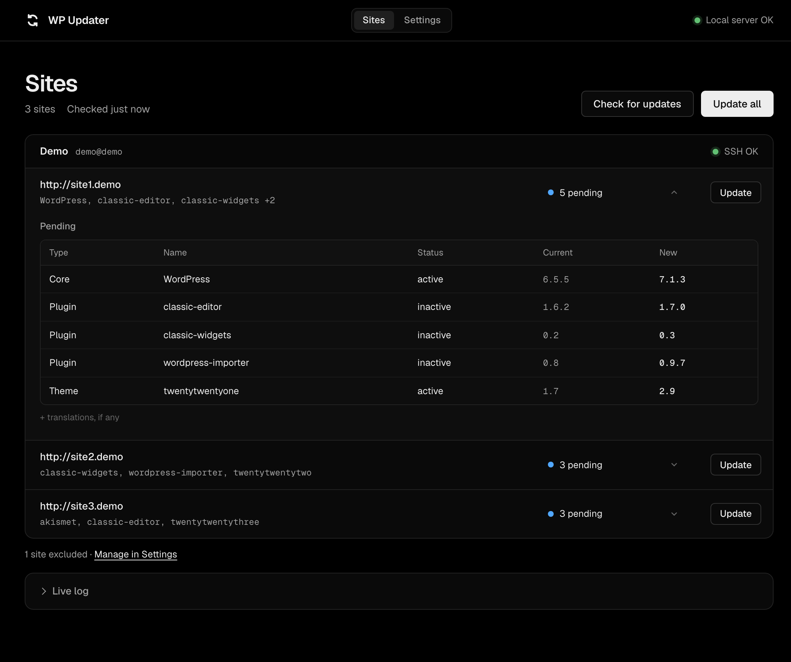

# WP Updater

**English** · [Español](README.es.md)

WP Updater is a free tool that runs on your computer and keeps all your WordPress sites up to date, on any number of servers, from one local web page. It connects to each server over SSH, backs up each site's database, and updates WordPress, plugins, themes and translations with WP-CLI. There is nothing to install on your sites, and no account or subscription.



## How it works

- The tool runs in Docker on your computer and opens a page at `http://localhost:8787`. Only your computer can reach it.
- It logs in to your servers with its own SSH key, which you add to each server once.
- On each server it finds the WordPress sites in the account's home folder and asks WP-CLI what's pending.
- Nothing is installed on the sites. Your settings, the SSH key and the backups stay on your computer, in the `data/` folder.

## Safety

- **A verified database backup before each site.** If the backup fails or comes out incomplete, that site is not updated.
- **Full backups, whenever you want:** a copy of the whole site on your computer, its database and all its files. You choose when and which sites, from **Sites**.
- **Excluded plugins, themes and sites** are never updated.
- **Duplicates are never updated.** Two installs that share a database or an address are flagged, and neither is updated until you exclude one. Updating a copy would upgrade the live site's database.
- **It never runs as root.** Files written by root end up owned by root, and then WordPress can't update or write them, so the site breaks. If the server account is root, "Test connection" refuses it.
- After each site, the tool loads its address and expects a working page.

> [!WARNING]
> Use it at your own risk. Try the demo or a staging site first.

## Requirements

**On your computer:**

- [Docker Desktop](https://www.docker.com/products/docker-desktop/) (on Linux, Docker Engine with the Compose plugin also works)
- [git](https://git-scm.com/downloads)

**On each server:**

- SSH access with key login
- bash
- [WP-CLI](https://wp-cli.org/) (the `wp` command)
- `mysqldump` or `mariadb-dump`
- `rsync`, only for full backups

"Test connection" checks all of this and tells you what's missing. Most shared hosts already have it.

## Quick start

```sh
git clone https://github.com/nicob201/wp-updater-free.git
cd wp-updater-free
docker compose up -d
```

Open <http://localhost:8787>.

The tool starts again on its own whenever Docker starts. To stop it, run `docker compose down` in the same folder: your settings, key and backups stay.

## Try the demo

The demo is a fake server with three outdated WordPress sites. Try it before you connect a real server.

1. Start it:

   ```sh
   docker compose --profile demo up -d
   ```

2. In the page, open **Settings** → **Add server** and fill in:
   - Name: `Demo`
   - Host: `demo`
   - Port: `22`
   - User: `demo`

   Click **Test connection**: it says OK. Then click **Save**. The demo already trusts the tool's key, so you don't need to add it.
3. Open **Sites**. You'll see four sites. `site1` and `site1-old` show **Duplicate**: `site1-old` is a copy of `site1` that uses the same database, so neither is updated.
4. Exclude the copy: in **Settings** → **Excluded sites**, tick **Exclude** next to `/home/demo/sites/site1-old`. Back in **Sites**, `site1` is ready to update.
5. Click **Update all** and watch each site get backed up and updated.

To reset the demo to its outdated sites and try again:

```sh
docker compose --profile demo up -d --force-recreate demo
```

When you're done, stop it with `docker compose --profile demo stop demo` and delete the Demo server in **Settings**.

## Connect your server

### 1. Copy the tool's key

Open **Settings**. Under **SSH key**, click **Copy**. This is a public key: it's safe to paste into your hosting panel.

### 2. Add the key to your server

Add it to the account that owns your sites. In the server form, the **Hosting** list fills in the usual port and repeats these steps.

#### Hostinger

1. In hPanel, open **Advanced** → **SSH Access**.
2. Turn SSH on if it's off.
3. Under **SSH keys**, add a key and paste the tool's key.
4. The same page shows your **IP** (the host), **port** (usually `65002`) and **username** (like `u123456789`).

#### cPanel

1. In cPanel, open **Security** → **SSH Access** → **Manage SSH Keys**.
2. Click **Import Key**, give it a name and paste the tool's key into the public key box. Leave the private key empty and import it.
3. Back in the key list, click **Manage** next to the new key, then **Authorize**.
4. The host is your domain, the user is your cPanel username, and the port is usually `22`.

Some hosts turn off SSH (shell access) or use another port. If it doesn't connect, ask your host's support.

#### SiteGround

1. In Site Tools, open **Devs** → **SSH Keys Manager**.
2. Open **Import**, give the key a name, paste the tool's key and import it.
3. In the key list, open the key's menu → **SSH Credentials**: it shows the host, username and port (usually `18765`).

#### VPS or your own server

1. Log in as the account that owns the site files, not as root. To see who owns a site, run `ls -l` in its folder.
2. Add the key to that account:

   ```sh
   mkdir -p ~/.ssh
   chmod 700 ~/.ssh
   echo 'PASTE-THE-KEY-HERE' >> ~/.ssh/authorized_keys
   chmod 600 ~/.ssh/authorized_keys
   ```

3. The host is the server's address or IP, the port is usually `22`, and the user is that account.

The tool looks for sites in the account's home folder, down to 5 folders deep. If your sites live somewhere else, like `/var/www`, put that folder in **Sites path**. The account must be able to log in over SSH: an account with no shell, like `www-data`, won't work.

### 3. Add the server

In **Settings** → **Add server**, pick your hosting, fill in the name, host, port and user, and click **Test connection**. When it says OK, click **Save**. The sites show up in **Sites** a few seconds later.

You can add as many servers as you want. "Update all" covers all of them.

## Daily use

- **Check for updates** asks every server what's pending. It also runs on its own when the tool starts, when you change the settings and after each update.
- Next to each site's address you see its WordPress version. Click a site to see what's pending: its current and new version.
- **Can't update here**, under a site's pending updates, lists the ones this server can't apply, with the reason, like "Needs PHP 8.3": the new version needs a newer WordPress or PHP than the site has. They don't count as pending and the tool skips them.
- **Update** updates that site. **Update all** updates every site with updates pending, one after another, on every server. Each site's database is backed up first, then WordPress, plugins, themes and translations are updated.
- You can close the page while it runs: the update keeps going. Open the page again to see the progress and the live log.
- **Full backups:** the gray line above your sites says the date of your oldest full backup, and how many sites were never backed up. **Back up sites…** opens a list: tick the sites, see how much room they take on your computer and click **Back up**. It runs in the background like an update, and nothing changes on the sites. A site that can't be backed up says why.
- A site marked **Check** needs a look: its update failed, or its page didn't load afterwards. The reason is next to it. You can update it again with its own **Update** button.
- **Excluded plugins & themes** (in **Settings**): add a plugin or theme by its slug, the name of its folder, like `elementor-pro`. It's never updated on any site, and it still shows in each site's list, marked as excluded. Nothing is excluded until you add it.
- **Excluded sites** (in **Settings**): tick **Exclude** to leave a site out. It's never checked nor updated, and nothing runs on it.
- **Duplicate** means that two installs share the same database or the same address, usually a copy like a staging or old folder. Neither is updated until you exclude one of them.

## Backups and restore

Backups live on your computer, in the `data/backups` folder, one folder per server and site:

```text
data/backups/<user>@<host>/<site address>/
  database.sql.gz        the database, from before the last update
  versions-before.txt    plugin and theme versions before the update
  full-backup/           the last full backup, from Back up sites…
    database.sql.gz      its database
    files/               all the site's files, without the UpdraftPlus and WPvivid backup folders
    backup.json          when it was made and how big it is
```

Only the latest backup of each site is kept: each update replaces the database backup, and each full backup replaces the previous one, but only once the new one is complete. If a full backup fails, the previous one stays. Folders named `files/` next to `full-backup/` come from older versions and can be deleted.

To undo a single plugin, you don't need a full restore. Log in to the server, go to the site's folder and install the old version listed in `versions-before.txt`:

```sh
wp plugin install <plugin> --version=<old version> --force
```

To restore a whole site, run these commands in the `wp-updater-free` folder. They use the tool's own key, so they work on any server you added. The examples restore the demo's `site1`: replace the user, host, port, backup folder and site folder with yours. **Settings** → **Excluded sites** shows each site's folder under its address.

### Restore the files

This replaces the site's files with the ones in its full backup and deletes files that aren't in it. It keeps the server's `wp-config.php`.

```sh
docker compose exec app rsync -az --delete --exclude /wp-config.php --exclude /wp-content/updraft --exclude /wp-content/wpvividbackups \
  -e "ssh -i /ssh/id_ed25519 -o UserKnownHostsFile=/ssh/known_hosts -p 22" \
  data/backups/demo@demo/site1.demo/full-backup/files/ demo@demo:/home/demo/sites/site1/
```

### Restore the database

1. Upload the backup to the server's home folder. To undo the last update, upload `database.sql.gz`, the database from before it:

   ```sh
   docker compose exec app scp -i /ssh/id_ed25519 -o UserKnownHostsFile=/ssh/known_hosts -P 22 \
     data/backups/demo@demo/site1.demo/database.sql.gz demo@demo:restore.sql.gz
   ```

   If you restored the files of a full backup, upload its own database instead, so both are from the same day:

   ```sh
   docker compose exec app scp -i /ssh/id_ed25519 -o UserKnownHostsFile=/ssh/known_hosts -P 22 \
     data/backups/demo@demo/site1.demo/full-backup/database.sql.gz demo@demo:restore.sql.gz
   ```

2. Log in to the server:

   ```sh
   docker compose exec app ssh -i /ssh/id_ed25519 -o UserKnownHostsFile=/ssh/known_hosts -p 22 demo@demo
   ```

3. On the server, go to the site's folder and load the backup with the site's own database credentials:

   ```sh
   cd /home/demo/sites/site1
   export MYSQL_PWD="$(wp config get DB_PASSWORD)"
   gunzip -c ~/restore.sql.gz | mysql -h "$(wp config get DB_HOST)" -u "$(wp config get DB_USER)" "$(wp config get DB_NAME)"
   rm ~/restore.sql.gz
   wp cache flush
   exit
   ```

## Update the tool

In the `wp-updater-free` folder:

```sh
git pull && docker compose up -d --build
```

Your settings, key and backups stay.

## Without Docker (macOS and Linux)

You need Node.js 24 or newer, bash, ssh, rsync and curl. In the `wp-updater-free` folder:

```sh
node server.js
```

Open <http://localhost:8787>. Everything is stored in `data/`, including the key in `data/ssh/`. Stop it with Ctrl+C. Windows needs Docker.

## Troubleshooting

**The port is already in use.** Run it on another port, like 9000, and open <http://localhost:9000>:

```sh
WPU_PORT=9000 docker compose up -d
```

To keep that port, or on Windows, create a file named `.env` in the `wp-updater-free` folder with the line `WPU_PORT=9000`, then run `docker compose up -d`.

**"The server's host key has changed."** The server was rebuilt or reinstalled, so it has a new identity. If you know why it changed, remove the old one. For a server on port 22, use its host:

```sh
docker compose exec app ssh-keygen -R example.com -f /ssh/known_hosts
```

For any other port, write it as `'[host]:port'`:

```sh
docker compose exec app ssh-keygen -R '[example.com]:65002' -f /ssh/known_hosts
```

If you don't know why it changed, ask your host before you do this: it can also mean someone is in the middle. Without Docker, run `ssh-keygen -R` with `-f data/ssh/known_hosts`.

**"Needs PHP 8.3", but your site already runs PHP 8.3.** WP-CLI checks the PHP the server uses over SSH, and on shared hosts it can be older than your site's. Ask your host how to use a newer PHP over SSH.

**"SSH rejected the key."** The tool's key isn't added to that account yet, or it was added to another account. Copy it again from **Settings** and check the user. On cPanel, check that the key is authorized.

**"WP-CLI (wp) is not installed."** Shared hosts usually have it. On a VPS, install it:

```sh
curl -O https://raw.githubusercontent.com/wp-cli/builds/gh-pages/phar/wp-cli.phar
php wp-cli.phar --info
chmod +x wp-cli.phar
sudo mv wp-cli.phar /usr/local/bin/wp
```

**"rsync is missing on this server."** Full backups copy the files with rsync, and this server doesn't have it. Updates still work. On a VPS, install it (`sudo apt install rsync` on Debian and Ubuntu). On a shared host, ask your host.

**"Can't write to the data folder."** Settings can't be saved and updates and backups can't start, because the tool can't write to `data/`.

- On Linux, the tool writes as user id 1000. If your user has another id (check with `id -u`), give the folder to that id: `sudo chown -R 1000:1000 data`.
- On macOS with Colima, keep the `wp-updater-free` folder inside your home folder.

## Tested on

| Where | Status |
| --- | --- |
| macOS, with the demo | ✓ |
| Hostinger | ✓ listing (updates tested on the demo) |
| Windows | pending |
| cPanel | not tested yet |
| SiteGround | not tested yet |
| VPS | not tested yet |

If you try it somewhere else, open an issue to share how it went.

## Contributing

- Run the tests with `node --test test/*.test.js`. They need Node.js 24 or newer and nothing else: there are no dependencies.
- Work on a branch and open a pull request against `main`. The tests and the Docker build run on every pull request.
- Commit messages follow [Conventional Commits](https://www.conventionalcommits.org/).

## License

[MIT](LICENSE)
